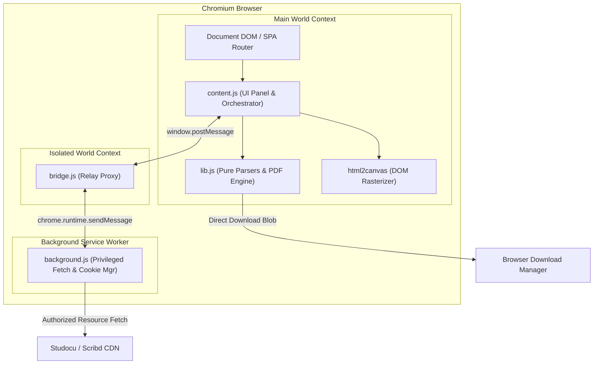

<div align="center">

# 📄 DocPress

### Chromium Extension for Exporting Studocu & Scribd Document Pages to PDF

[](https://github.com/nguyenquan27122005-cmd/docpress/releases)
[](https://developer.chrome.com/docs/extensions/mv3/intro/)
[](https://github.com/nguyenquan27122005-cmd/docpress/actions)
[](LICENSE)
[](https://github.com/nguyenquan27122005-cmd/docpress/pulls)

<p align="center">
  <a href="#-key-features">Key Features</a> •
  <a href="#-supported-platforms--browsers">Supported Platforms</a> •
  <a href="#-installation">Installation</a> •
  <a href="#-how-to-use">How to Use</a> •
  <a href="#-architecture">Architecture</a> •
  <a href="#-quality-presets">Quality Presets</a> •
  <a href="#-development--testing">Testing</a> •
  <a href="#-ti%E1%BA%BFng-vi%E1%BB%87t">Tiếng Việt</a>
</p>

</div>

---

> [!NOTE]
> **1.2.1 fixes:** Public CDN image loading, missing page dimensions, Scribd sprite clipping/viewer zoom, and malformed bridge messages are covered by actual-extension regression tests. The live test now clicks the export button and checks the downloaded PDF. Scribd's public sample was verified visually; Studocu returned HTTP 403 (Access Blocked), so a live export could not be verified. See the [audit and remediation notes](https://github.com/nguyenquan27122005-cmd/docpress/blob/main/docs/AUDIT-2026-10-19.md).

## 🌟 Overview

**DocPress** is a lightweight, privacy-focused Chromium extension that captures and converts rendered document pages from **Studocu** and **Scribd** directly into high-quality PDF files downloaded straight to your browser.

> [!NOTE]
> All processing happens client-side directly within your browser. No third-party servers, tracking, or external telemetry are involved.

---

## ✨ Key Features

- ⚡ **Direct Client-Side Rendering**: Captures document content as one JPEG per PDF page. Text and vectors are rasterized; output text is not selectable.
- 🎯 **Smart Adaptive Quality**: Dynamically switches resolution and compression based on page count to optimize quality vs file size.
- 🔓 **Scribd Preview Unblur**: Built-in toolbar popup toggle to automatically bypass Scribd document preview restrictions.
- 🛡️ **Robust Manifest V3 Architecture**: Separated privileged network bridge, main world content scripts, and background service workers for maximum security and stability.
- ⏱️ **Zero UI Blocking**: Asynchronous worker queues and cancellation tokens allow seamless aborting and background processing.
- 🌐 **Single Page Application (SPA) Aware**: Automatically detects document view navigation and dynamically mounts/unmounts the floating control panel.

---

## 🌐 Supported Platforms & Browsers

### Document Providers
| Provider | Domains Supported | Features Supported |
| :--- | :--- | :--- |
| **Studocu** | `*.studocu.com`, `*.studeersnel.nl`, `*.studocu.vn`, `*.studocu.id` | Full page export, HD background raster, page range selection |
| **Scribd** | `*.scribd.com`, `*.scribdassets.com` | Unblur preview toggle, JSONP text & image reconstruction, PDF export |

### Compatible Browsers
- Google Chrome (Desktop)
- Microsoft Edge
- Brave Browser
- Opera / Opera GX
- Cốc Cốc

---

## 🚀 Installation

### Option 1: Load Unpacked (Recommended for Development)

1. **Clone or Download** this repository:
   ```bash
   git clone https://github.com/nguyenquan27122005-cmd/docpress.git
   ```
2. Open your browser's extension manager:
   - Chrome: Navigate to `chrome://extensions`
   - Edge: Navigate to `edge://extensions`
   - Cốc Cốc: Navigate to `coccoc://extensions`
3. Enable **Developer Mode** (toggle switch in the top-right corner).
4. Click **Load unpacked** and select the `docpress` project folder.

### Option 2: Pre-packaged ZIP

1. Download [`docpress.zip`](docpress.zip) from the repository or release page.
2. Extract the archive into a permanent folder.
3. Follow the **Load unpacked** steps above.

---

## 📖 How to Use

### 1. Exporting Documents to PDF
1. Navigate to any document page on **Studocu** or **Scribd**.
2. A floating control panel will automatically appear in the bottom-right corner.
3. Configure your export settings:
   - **From Page / To Page**: Enter custom page ranges or leave blank to export all pages.
   - **Quality**: Choose between `Auto`, `High`, `Balanced`, or `Light`.
4. Click **PDF**. The panel will display real-time progress, captured page count, and estimated file size.
5. Once completed, your PDF will automatically download.

### 2. Scribd Preview Unblur Toggle
1. Click the **DocPress** extension icon on your browser toolbar.
2. Toggle the **Unblur Scribd** switch ON or OFF.
3. The extension will automatically clear restriction cookies (`sd_docs`) without affecting your login session.

---

## 🏗️ Architecture



---

## ⚙️ Quality Presets

| Preset | Target DPR / Scale | JPEG Quality | Auto Threshold | Best For |
| :--- | :---: | :---: | :---: | :--- |
| **Auto** | *Dynamic* | *Dynamic* | Default | Automatically selects optimal settings based on page count |
| **High** | 2.0x | 92% | 1 – 40 pages | Short documents requiring crystal-clear text & diagrams |
| **Balanced** | 1.5x | 88% | 41 – 100 pages | Medium documents with good clarity and reasonable file size |
| **Light** | 1.0x | 80% | 101+ pages | Large textbooks / lengthy slides to prevent high memory usage |

---

## 🧪 Development & Testing

The project includes an automated test suite with 100+ unit and integration tests covering parser logic, range clamping, streaming limits, byte budget protection, and mock network flows.

### Run Unit Tests
```bash
# Run unit test suite (Zero dependencies required)
npm test
# or
node test.mjs
```

### Run Actual-Extension Browser Tests

These tests use Python 3.10+ and Playwright Chromium. Install the optional test dependencies once:

```bash
python -m pip install -r audits/2026-10-19/requirements.txt
python -m playwright install chromium
npm run test:browser
```

The controlled tests verify downloaded PDF content, page bounds, sprite clipping, error cleanup, cancellation, and extension messaging. CI runs them alongside the fast Node tests.

### Run Live Download Smoke Tests
```bash
# Loads the actual extension in a fresh Chromium profile
npm run test:real
# or
node real-test.mjs
```

This test clicks the real export button for visible page 1 and validates the downloaded PDF. Unavailable provider data, navigation blocks, export errors, and missing downloads fail the test. It saves PDF/PNG evidence in a fresh temporary directory; inspect the PNG for live visual completeness. Use `npm run test:real -- --headed` for a visible browser, or set `PYTHON` to your Python executable. See the [audit notes](https://github.com/nguyenquan27122005-cmd/docpress/blob/main/docs/AUDIT-2026-10-19.md) for coverage limits.

---

## 📁 Repository Structure

```
docpress/
├── .github/
│   └── workflows/
│       └── ci.yml             # Automated GitHub Actions test pipeline
├── background.js              # Background service worker (privileged fetch & cookies)
├── bridge.js                  # Isolated world bridge relay for secure IPC
├── content.js                 # Floating UI, SPA lifecycle, canvas capture & orchestrator
├── lib.js                     # Pure business logic (PDF synthesizer, parsers, quality math)
├── html2canvas.min.js         # Canvas rendering engine
├── manifest.json              # Chrome Extension Manifest V3 configuration
├── popup.html                 # Extension toolbar action popup UI
├── popup.js                   # Popup toggle event handling
├── test.mjs                   # Fast unit test suite (100+ assertions)
├── real-test.mjs              # Actual-extension live download smoke test
├── package.json               # Project manifest & npm scripts
├── LICENSE                    # MIT License
└── README.md                  # Project documentation
```

---

## 🇻🇳 Tiếng Việt

<details>
<summary><b>Nhấn vào đây để xem hướng dẫn bằng Tiếng Việt</b></summary>
<br/>

### Giới thiệu
**DocPress** là tiện ích mở rộng Chromium giúp xuất tài liệu đang xem trên **Studocu** và **Scribd** thành file PDF hoàn chỉnh, tải trực tiếp vào trình duyệt mà không cần cài đặt phần mềm bên ngoài.

### Tính năng chính:
- **Xuất PDF trực tiếp từ trình duyệt**: Tự động tổng hợp các trang tài liệu với chất lượng sắc nét.
- **Tự động tối ưu dung lượng (Auto Quality)**: Tự động điều chỉnh độ phân giải phù hợp theo số lượng trang để tránh tràn RAM hoặc file quá nặng.
- **Mở khóa xem trước Scribd (Unblur)**: Tích hợp công tắc bật/tắt tự động xử lý cookie giới hạn xem trước của Scribd.
- **Hỗ trợ đầy đủ SPA**: Tự động hiển thị thanh điều khiển khi vào trang tài liệu và ẩn đi khi chuyển trang.

### Hướng dẫn cài đặt nhanh:
1. Tải repository này về máy.
2. Mở `chrome://extensions` hoặc `coccoc://extensions` trên trình duyệt.
3. Bật **Chế độ dành cho nhà phát triển (Developer mode)**.
4. Chọn **Tải tiện ích đã giải nén (Load unpacked)** và trỏ đến thư mục `docpress`.

</details>

---

## 🔒 Privacy & Security

- **No Remote Servers**: All page capture, image stitching, and PDF binary synthesis are performed entirely in the local browser runtime.
- **No Data Collection**: No cookies, credentials, or document contents are ever transmitted to any third-party telemetry or analytics services.
- **Isolated Permissions**: Host permissions are strictly restricted to Studocu and Scribd domains.

---

## ⚖️ Disclaimer

This software is developed for personal educational and study purposes only. Please respect the intellectual property rights of document authors and do not distribute copyrighted materials.

---

## 📄 License

This project is licensed under the [MIT License](LICENSE).
